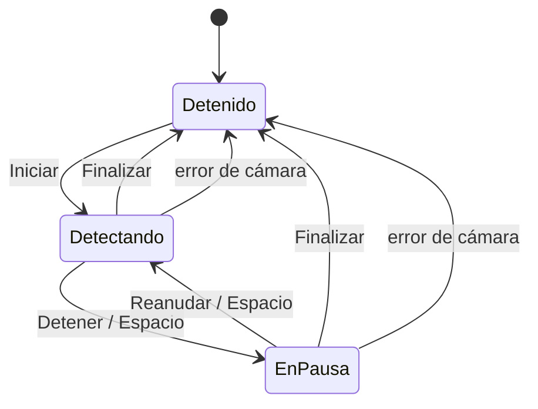

# SOFIA — Interfaz gráfica de control

Este documento corresponde a la actividad de desarrollo de la interfaz
gráfica (GUI). Incluye:

1. La arquitectura de la aplicación y el modelo de hilos.
2. El wireframe y la distribución de los elementos.
3. El flujo de interacción y los controles de detección.
4. La justificación del framework elegido.
5. Las decisiones de diseño y cómo se prepara la integración con sOFla y el
   ESP32.

---

## 1. Arquitectura

### 1.1 Módulos

La aplicación separa la detección de la presentación. La lógica de visión no
depende de ninguna interfaz, y la GUI no contiene lógica de detección.

| Módulo | Responsabilidad |
|---|---|
| `gestures.py` | Clasificación de posturas, filtros de suavizado y reconocimiento de gestos. |
| `detection.py` | Cámara, MediaPipe y reconocedor: un cuadro de entrada, un resultado `Detection` de salida. Incluye `DetectionWorker`, que ejecuta todo en un hilo de fondo. |
| `gui/bridge.py` | `DetectionBridge`: adapta el `DetectionWorker` a señales de Qt. |
| `gui/video_view.py` | `VideoView`: dibuja el último cuadro escalado a la ventana. |
| `gui/main_window.py` | `MainWindow`: distribución, controles, panel de resultados y registro de eventos. |
| `tracker.py` | Interfaz de línea de comandos (ventana de OpenCV), usa el mismo pipeline. |

Como la GUI, `tracker.py` y `evaluate.py` usan el mismo `DetectionPipeline`,
los resultados de la evaluación (U1) son válidos para lo que muestra la GUI.

### 1.2 Modelo de hilos

El procesamiento de video se ejecuta en un **hilo de detección** separado del
**hilo de la interfaz**. El hilo de la interfaz solo dibuja y atiende al
usuario, así que nunca se bloquea por la captura ni por MediaPipe (~35-45 ms
por cuadro).

```
 Hilo de detección (DetectionWorker)            Hilo de la interfaz (Qt)
 ───────────────────────────────────            ─────────────────────────
 Cámara.read()                                  MainWindow
     │                                              ▲   │
 DetectionPipeline.process()                        │   │ clic en botón
     │  (MediaPipe + gestos)                        │   ▼
 draw_detection()                                señales   DetectionBridge
     │                                          (en cola)   .start() .pause()
 on_frame / on_state_change / on_error ──────────►          .resume() .stop()
                                                                 │
             ◄──────── controles (eventos y estado protegidos) ──┘
```

- **Del hilo de detección a la interfaz:** el worker llama a sus callbacks y
  `DetectionBridge` los convierte en señales de Qt (`frame_ready`,
  `state_changed`, `gesture_detected`, `error`). Qt entrega las señales
  emitidas desde otro hilo como eventos en cola del hilo de la interfaz, que
  es el único que modifica los widgets.
- **De la interfaz al hilo de detección:** los botones llaman a `start()`,
  `pause()`, `resume()` y `stop()`. Estos métodos solo cambian un estado
  protegido por un candado (`lock`) o activan un evento (`threading.Event`);
  el hilo los revisa en cada cuadro. Ninguno espera a la cámara, por lo que
  la interfaz responde de inmediato.

### 1.3 Política de cuadros: solo el más reciente

Si la interfaz tarda en dibujar (por ejemplo, al redimensionar la ventana),
no conviene acumular cuadros en la cola de eventos: aumentaría la latencia y
el uso de memoria. `DetectionBridge` guarda **solo el último cuadro** y
programa una entrega únicamente si no hay otra pendiente. Los cuadros
intermedios se descartan, pero **los gestos nunca se descartan**: se emiten
con una señal propia (`gesture_detected`) independiente de los cuadros.

---

## 2. Wireframe

```
┌ SOFIA — Control ───────────────────────────────────────────────┐
│ ┌────────────────────────────────┐ ┌ Detección ──────────────┐ │
│ │                                │ │ Postura:      V         │ │
│ │                                │ │ Último gesto: V         │ │
│ │        VIDEO EN VIVO           │ │ Acción SOFIA: dibujar   │ │
│ │  (esqueleto + centroide de     │ │   un 8 horizontal       │ │
│ │   la palma superpuestos)       │ │ Objetivo:  (0.42, 0.61) │ │
│ │                                │ │ Rendimiento: 25 FPS ·   │ │
│ │                                │ │   43 ms                 │ │
│ │                                │ ├ Configuración ──────────┤ │
│ │                                │ │ Cámara: [0 ▴▾]          │ │
│ │                                │ │ ☑ Suavizado             │ │
│ └────────────────────────────────┘ └─────────────────────────┘ │
│ [▶ Iniciar] [⏸ Detener] [⏩ Reanudar] [■ Finalizar]             │
│ ┌ Eventos ───────────────────────────────────────────────────┐ │
│ │ 12:03:04  V → dibujar un 8 horizontal                      │ │
│ │ 12:02:57  SWIPE_LEFT → ola hacia la izquierda              │ │
│ └────────────────────────────────────────────────────────────┘ │
│                                                  ● Detectando  │
└────────────────────────────────────────────────────────────────┘
```

| Zona | Contenido | Motivo |
|---|---|---|
| Video (izquierda) | Cuadro en vivo con el esqueleto de la mano, el centroide sin filtrar (rojo) y el suavizado (verde). | Es el elemento principal: ocupa el espacio sobrante y conserva la proporción de la imagen. |
| Detección (derecha) | Postura actual, último gesto, acción de SOFIA asociada, objetivo normalizado (0-1), FPS y tiempo de procesamiento. | Muestra el resultado como texto legible, sin tapar el video. |
| Configuración (derecha) | Índice de cámara y suavizado. | Se aplican al pulsar «Iniciar»; se bloquean mientras la detección está activa. |
| Controles (debajo del video) | Iniciar, Detener, Reanudar, Finalizar. | Cerca del video, en el orden en que se usan. |
| Eventos (abajo) | Historial de gestos con hora, el más reciente arriba (máximo 200). | Permite verificar qué se reconoció aunque el gesto ya haya pasado. |
| Barra de estado | Indicador de color: Detenido (gris), Detectando (verde), En pausa (ámbar). | El estado del proceso siempre es visible. |

---

## 3. Flujo de interacción

### 3.1 Estados y controles



| Control | Efecto sobre el hilo de detección | Habilitado en |
|---|---|---|
| **Iniciar** | Crea el hilo, abre la cámara y carga el modelo con la configuración elegida. | Detenido |
| **Detener** | El hilo sigue capturando y mostrando video, pero deja de ejecutar la detección. | Detectando |
| **Reanudar** | El hilo vuelve a detectar. Antes reinicia el historial de gestos y los filtros. | En pausa |
| **Finalizar** | El hilo termina y libera la cámara. | Detectando, En pausa |

La tecla **Espacio** alterna entre Detener y Reanudar. Los botones que no
aplican al estado actual se deshabilitan, y el worker además ignora un
control que no aplica, así que un clic doble no tiene efectos inesperados.

### 3.2 Secuencia típica

1. El usuario elige la cámara y pulsa **Iniciar**. La configuración se
   bloquea y el indicador cambia a «Detectando».
2. El video aparece con la superposición; el panel muestra la postura y el
   objetivo en cada cuadro.
3. Al reconocer un gesto, se actualizan «Último gesto» y «Acción SOFIA» y se
   añade una línea al registro de eventos.
4. **Detener** congela la detección sin apagar la cámara; **Reanudar** la
   retoma.
5. **Finalizar** (o cerrar la ventana) libera la cámara y vuelve a
   «Detenido».

Si la cámara no se puede abrir o deja de responder, la aplicación muestra un
cuadro de diálogo con el error y vuelve a «Detenido» sin cerrarse.

---

## 4. Justificación del framework

### 4.1 Elección: PySide6 (Qt for Python 6)

| Criterio | PySide6 |
|---|---|
| Lenguaje | Python, el mismo que el pipeline de detección: se importa directamente, sin servicios ni puentes. |
| Concurrencia | Señales y slots seguros entre hilos: una señal emitida desde el hilo de detección se entrega en cola al hilo de la interfaz, sin sincronización manual. |
| Video | `QImage` acepta el formato BGR de OpenCV (`Format_BGR888`) sin convertir los colores; el dibujo escalado se hace con `QPainter`. |
| Licencia | Binding oficial de The Qt Company, bajo **LGPL**: se puede usar en el proyecto sin abrir el código de terceros. |
| Plataformas | Linux, macOS y Windows con el mismo código; se instala con `pip` (wheels para Python 3.12). |
| Integración futura | Qt incluye `QtNetwork` (UDP/TCP), `QtSerialPort` y `QtWebSockets`, útiles para la comunicación con el ESP32 y con la interfaz web del celular. |
| Pruebas | `pytest-qt` permite pulsar botones y esperar señales en pruebas automáticas, sin pantalla (`QT_QPA_PLATFORM=offscreen`). |

### 4.2 Alternativas consideradas

| Alternativa | Motivo para descartarla |
|---|---|
| **Tkinter** | Viene con Python, pero no es seguro llamar a sus widgets desde otro hilo: habría que sondear una cola con `after()`. Mostrar video requiere convertir cada cuadro con Pillow, y el aspecto es más limitado. |
| **PyQt6** | Equivalente técnico de PySide6, pero con licencia GPL o comercial. PySide6 es el binding oficial y es LGPL. |
| **Kivy** | Pensado para interfaces táctiles con OpenGL. Añade un modelo de widgets y un lenguaje (`.kv`) propios, sin ventaja para una aplicación de escritorio. |
| **Web (Streamlit, Gradio, Flask)** | Se ejecuta el script de nuevo con cada interacción (Streamlit) o requiere un servidor y enviar el video al navegador, lo que añade latencia. Además, los controles no actúan directamente sobre un hilo local. |
| **OpenCV `imshow`** | Ya se usa en `tracker.py`, pero no ofrece botones ni paneles, y su bucle de eventos depende de `waitKey` en el mismo hilo que el procesamiento. |

---

## 5. Decisiones de diseño

- **Detener no apaga la cámara.** En pausa, el video sigue en vivo y solo se
  omite la detección. El usuario puede reacomodarse frente a la cámara y
  reanudar sin esperar a que se abra de nuevo. «Finalizar» sí libera la
  cámara.
- **Reanudar reinicia el historial.** Si se conservaran los filtros y la
  ventana de movimiento de antes de la pausa, el salto de posición se
  interpretaría como un deslizamiento falso.
- **Finalizar no bloquea la interfaz.** El botón solo pide al hilo que
  termine; la interfaz muestra «Finalizando…» y habilita «Iniciar» cuando el
  worker confirma que liberó la cámara. Al cerrar la ventana sí se espera
  (hasta 2 s) para no dejar la cámara abierta.
- **Los botones reflejan el estado real.** La ventana consulta el estado del
  worker en lugar de confiar en el valor de una señal, porque una señal en
  cola puede llegar después de un cambio más reciente.
- **La configuración se aplica al iniciar.** Cambiar de cámara o de
  suavizado a mitad de la detección exigiría reiniciar el pipeline; bloquear
  esos controles mientras corre evita estados intermedios.
- **Interfaz en español, código en inglés.** Los textos visibles están en
  español para los usuarios; los nombres del código siguen en inglés, como el
  resto del repositorio.

---

## 6. Preparación para la integración

La GUI se construyó pensando en las siguientes etapas:

- **Acciones de sOFla y comandos al ESP32.** Cada gesto reconocido se emite
  con la señal `DetectionBridge.gesture_detected(evento, marca_de_tiempo)`.
  El módulo de comunicación con el ESP32 Maestro se conectará a esa señal
  para traducir el gesto en un comando, sin modificar la detección ni la
  ventana.
- **Seguimiento de la mano.** Cada `Detection` incluye `target_norm`, el
  centroide suavizado de la palma normalizado a 0-1, listo para mapearse a
  la orientación de las unidades del panel.
- **Estado de la conexión.** El panel lateral y la barra de estado admiten
  un grupo adicional («ESP32») con el estado de la conexión y los
  acknowledgements, que se añadirá junto con el protocolo.

---

## 7. Ejecución y pruebas

```bash
source .venv/bin/activate
pip install -r requirements.txt
python -m gui                  # cámara 0
python -m gui --camera 1       # otra cámara
```

Las pruebas automáticas usan una cámara y un pipeline simulados, por lo que
no necesitan webcam ni pantalla:

```bash
pip install -r requirements-dev.txt
pytest
```

Verifican las transiciones del worker (iniciar, detener, reanudar,
finalizar, reinicio y errores de cámara) y la GUI completa a través de sus
botones: habilitación de controles por estado, video en pantalla, registro
de gestos, tecla Espacio y manejo de errores.
